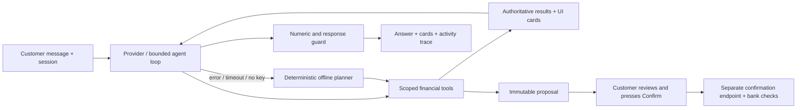
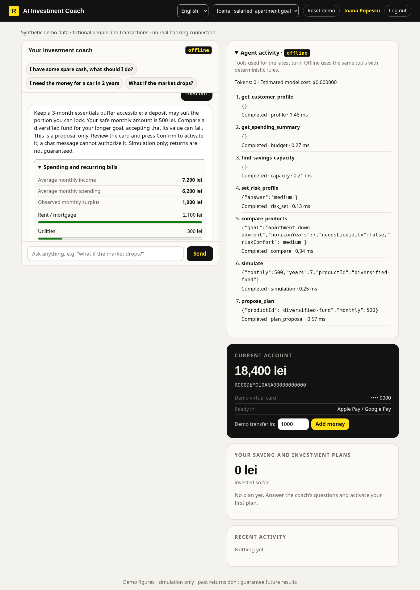
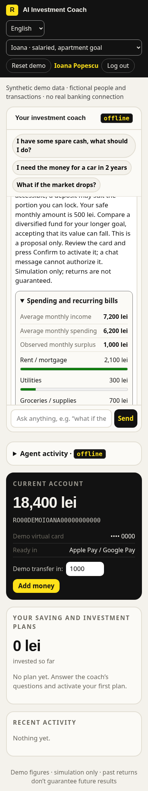

# NEXXT-AI · Raiffeisen AI Investment Coach

> **For the jury:** [JUDGING.md](JUDGING.md) maps each of the six assessment criteria to concrete files, tests and eval scenarios. To check everything in one command (Node 20+, no install):
>
> ```bash
> npm run setup && npm run verify   # 154 tests, 86/86 scenarios (25/25 safety), end-to-end core scenario
> ```
>
> Domain rules and constraints: [docs/DOMAIN.md](docs/DOMAIN.md). Users, value and adoption: [docs/BUSINESS.md](docs/BUSINESS.md).

## Hackathon submission

**Track: AI for Scaling & Growth · Raiffeisen NEXXT VibeHack.** People need a decision they can act on: whether they can afford to invest, what they must keep accessible, and which product fits their goal. This demo serves salaried customers, students, freelancers and a small business using fictional profiles and twelve months of deterministic synthetic transactions.

The configured model chooses and calls 11 validated tools through a bounded loop. It reads customer context, calculates capacity, compares products, cites the relevant rules (`check_rules`), explores changes and proposes a plan. With no key or a provider failure (including one in the middle of a turn), a visibly labeled **offline** planner calls the same tools and finishes the turn. Offline is rule-based; it is not presented as an AI model.



**Real in this repository:** the HTTP app, tool execution, capacity arithmetic, illustrative simulation, provider adapters, session scoping, proposal expiry and confirmation checks, audit, tests, evaluation and measurements. **Mocked:** people, transactions, product terms and returns, bank accounts, identity verification, SMS, phone approval and money movements. Data is fixed as of **2026-02-28** for repeatable demonstrations; the March tax obligation is relative to that synthetic date. No bank or eKYC service is connected.

Safety comes before conversion. Buffers, taxes and payroll are protected, product segment and suitability are checked on the server, model replies cannot invent numeric figures, and every activation needs the separate Confirm action. A chat message saying “yes” cannot activate a plan. Debits are separate demo actions and also preserve protected reserves. Merchant and profile text are untrusted data; tools accept no customer identifier.

**Evidence:** [EVAL_REPORT](docs/EVAL_REPORT.md) records **86/86 scripted scenarios**, including **25/25 safety scenarios**; `npm test` runs **154 tests** and `npm run verify` passes **11/11 checks**. This is deterministic CI evidence, not a live-model score. The configured Bedrock smoke run returned **0/5 live passes (HTTP 403 access denied)**; `npm run smoke:live` has not yet been run with a real `ANTHROPIC_API_KEY`, so no live pass is claimed; full live quality remains unvalidated and the 90% live target is not claimed. [SCALE](docs/SCALE.md) records a short local run of **20/20 journeys, 80 requests, 409.49 requests/sec**, p50 **13.3 ms**, p95 **65.78 ms**, p99 **92.04 ms**, with limits enabled. These are loopback measurements with the app and load generator in one process, not production capacity. See [REPORT](REPORT.md) for the complete checklist and limitations.

### Run in 60 seconds

Needs Node 20+; no dependencies and no build. Node 24+ is recommended for the managed cloud proxy.

```bash
npm run setup          # creates .env only if absent; random local ADMIN_TOKEN
npm start
```

Open the app on port 3000, choose a **demo persona** in the header, click their suggested first prompt, then answer the risk question. The badge says `offline` without a configured key. `/ad` retains the anonymous acquisition flow; `/admin` retains the funnel and adds planning metrics. Use **Reset demo** before each presentation. The documented phone/email login is the same Ioana account as the persona switcher. After the anonymous simulation, **Connect my accounts (demo)** reads a selected sample and lets the agent analyze it before login. Get the local admin token from the ignored configuration using your editor; do not paste it into logs or version control.

```bash
npm run verify                  # tests + scripted eval + end-to-end HTTP walk; prints a PASS/FAIL checklist
npm run verify:e2e              # only the end-to-end core scenario
npm test
npm run eval
npm run eval -- --live          # exits 2 if no real provider key is configured
npm run loadtest
npm run smoke:live             # exit 2 with no key; exit 1 on a failed live path or any fallback (SMOKE_ALLOW_FALLBACK=1 allows fallbacks)
npm run impact -- --visitors=10000 --chatRate=0.15 --accountRate=0.3 --activationRate=0.35 --monthly=300
npm run loadtest -- --concurrency=10 --journeys=20 --write-report
```

`npm test` uses a shell glob (`test/*.test.js`), so it needs a POSIX shell (bash, zsh, Git Bash, WSL). `npm run verify` lists the test files itself and works in any shell, including Windows `cmd`.

`npm run eval` writes the latest executed report. Live mode fails a quality scenario when a normal turn falls back to offline, preventing a fallback from being counted as live success. `loadtest` uses an isolated temporary JSON store, cycles all four personas and stops at a proposal; it never calls a provider or moves money. A larger burst can exit 1 with HTTP 429; that is an honest failed run.

### Docker and CI

A [Dockerfile](Dockerfile) (node:20-alpine, non-root user, healthcheck on `/api/config`) runs the same app with `DEMO_MODE=1`. Pass a strong `ADMIN_TOKEN`; optional provider keys can be added with `-e`.

```bash
docker build -t nexxt-ai . && docker run --rm -p 3000:3000 -e ADMIN_TOKEN=change-me nexxt-ai
```

The image was not built in our development sandbox (no working container runtime there); the container environment was checked by booting `server.js` with the same variables. [CI](.github/workflows/ci.yml) runs `npm test`, `npm run eval` and `npm run verify:e2e` on Node 20 and 22 with `LLM_PROVIDER=offline`, so no model provider is ever contacted.

### Providers, including Amazon Bedrock

Set values securely in `.env` or environment settings; all variables are described in [.env.example](.env.example). Never commit keys. An explicit `LLM_PROVIDER=anthropic`, `openai`, `bedrock` or `offline` always wins. When it is blank, the first configured key is used in this order: **anthropic** (`ANTHROPIC_API_KEY`) > **openai** (`COMPAT_API_KEY`) > **bedrock** (`AWS_BEARER_TOKEN_BEDROCK`) > **offline**. With both an Anthropic key and a Bedrock token set, Anthropic is selected. An explicit provider whose key is missing runs offline.

| Provider | Required configuration |
|---|---|
| Anthropic Messages (streaming) | `ANTHROPIC_API_KEY`; optionally `COACH_MODEL` (default `claude-sonnet-5-5`, not yet verified against the live API) |
| OpenAI-compatible Chat Completions | `COMPAT_API_KEY`, `COMPAT_BASE_URL` including the API prefix (for example `/v1`), and a compatible `COACH_MODEL` (default `gpt-4.1-mini`) |
| Amazon Bedrock Converse | `AWS_BEARER_TOKEN_BEDROCK`, `AWS_REGION=eu-west-2`, and the exact `BEDROCK_MODEL_ID` or inference-profile ID/ARN |

Bedrock uses the regional HTTPS runtime endpoint and API-key bearer authentication, with no SDK dependency. **The requested Opus 5.5 identifier and availability in London are not verified.** Copy the identifier from the Bedrock console; do not use the display name or silently substitute another model. Adapters have mocked protocol tests. The latest configured Bedrock calls received HTTP 403 AccessDeniedException; no real model response has been validated. The configured model identifier does not match the requested Opus model; correct the secure key/access and exact console model/profile identifier before repeating the smoke run. See [LIVE_RUNBOOK](docs/LIVE_RUNBOOK.md).

**Anthropic streaming and prompt caching.** The Anthropic adapter calls the Messages API with `stream: true` and `temperature: 0`, and parses the server-sent events with `fetch` and a line reader (no SDK). The system prompt is sent as two blocks: the fixed coach instructions marked `cache_control: {type: "ephemeral"}`, then the per-session context. Tool input is assembled only from `input_json_delta` fragments; thinking, signature and citation deltas are ignored, and an empty tool input becomes `{}`. Usage includes `cache_read_input_tokens` and `cache_creation_input_tokens` when the API reports them. `LLM_FIRST_TOKEN_MS` (default 6000) aborts the call with a `timeout` error if no stream event arrives in time or the gap between two events is longer. The OpenAI-compatible and Bedrock adapters append the session context to the system prompt.

**Tool guard.** Before every tool runs, in both the live and the offline path, [src/agent/guard.js](src/agent/guard.js) checks it. A failed check does not run the tool; the model receives `{status: "REJECTED", code, detail}` with one of these codes:

| Code | Meaning |
|---|---|
| `UNKNOWN_TOOL` | No tool with that name exists. |
| `NOT_MODEL_CALLABLE` | The tool is reserved for the customer or the bank (for example `activate_plan`, `confirm_plan`, `move_money`, `transfer_money`, `execute_debit`). The model can never activate a plan or move money. |
| `INVALID_ARGS` | The arguments fail the tool's schema. |
| `PRECONDITION_NOT_MET` | A precondition from the table in [src/tools/index.js](src/tools/index.js) is missing, for example `propose_plan` needs `risk_answered` and `capacity_computed`. |
| `DUPLICATE_CALL` | The same tool with the same arguments already ran successfully this turn. |

Each rejection is audited and shown in the Activity timeline as `guard: <CODE>`.

**Mid-turn failover.** If the live provider fails after some tool calls succeeded, the offline planner finishes the same turn. Tools that already returned results are not run again, text streamed before the failure is kept (`streamedText`), and the tool calls from the failed provider call are dropped. A `fallback` event is emitted and the server logs `[nexxt] live provider failed: <code>`. A client that disconnects aborts the provider call instead: no fallback runs, no messages are persisted and the request ends with HTTP 499.

**Visible mode.** The chat header badge shows `Live · <model>` when the turn was answered by the model, otherwise `Offline planner`. `GET /api/config` reports `provider` and `model`. When a live turn falls back, a short notice with the reason appears under that coach reply and in the Activity panel. `npm run smoke:live` exits 0 only when every turn stayed live, 1 if any turn failed or fell back (unless `SMOKE_ALLOW_FALLBACK=1`), and 2 when no provider is configured. It has not been run with a real `ANTHROPIC_API_KEY` in this environment, so no live pass is claimed.

In this managed environment, enable Node 24's inherited proxy support **before starting Node**, keep the injected proxy/CA variables, and allow only the required provider destination:

```bash
NODE_USE_ENV_PROXY=1 npm start
NODE_USE_ENV_PROXY=1 npm run eval -- --live
```

For Bedrock the destination is `bedrock-runtime.eu-west-2.amazonaws.com`. Proxy secret bindings must target it. Anthropic uses `api.anthropic.com`; a compatible service uses the hostname from its configured base URL. `NODE_USE_ENV_PROXY` in `.env` alone is not a substitute for startup activation. Node 20 remains supported for the app and direct-network use; use Node 24+ for this proxy path.

**Visible orchestration timeline.** Every tool call in a turn is recorded as a numbered trace step with `step`, `iteration` (planning loop round), `source` (`agent` when the live model chose it, `offline` for the deterministic planner), `why` (rationale code such as `need_capacity` or `make_proposal`), the validated `input`, a compact PII-free `result` (for example `safeMonthly=500, buffer=10200`), status and ms. The chat **Activity** panel (open by default on desktop in demo mode) renders this as a timeline with a header showing mode, fallback reason, model calls and tool steps. The same data is in the `trace` field of `POST /api/agent`. For Ioana, "I have some spare cash, what should I do?" then "medium" shows 7 steps over 4 iterations ending in `propose_plan` (no money moves until confirmation).

**Agent decision graph.** Each turn also returns `decisions` (nodes) and `decisionEdges`, derived from the trace, tool results and reply guard in both live LLM and offline modes: intent, then decision points such as `buffer_ready: yes -> compare_products` (with the branch not taken greyed out), the tools, and a final outcome (`proposal`, `ask_risk_question`, `handoff`, `refusal`, `rules_answer`), rendered as a vertical flow above the Activity timeline.

The loop caps tool iterations at six, total time at 30 seconds (raise with `LLM_TIMEOUT_MS`, up to 60 000), each provider call at 20 seconds by default (`LLM_CALL_TIMEOUT_MS`), and provider usage at the configured token budget. Transient 429/5xx/reset failures get one short retry bounded by the deadlines. The session-owned activity poll shows actual steps while the POST is pending. Configure actual per-million token rates with `LLM_INPUT_USD_PER_MILLION` and `LLM_OUTPUT_USD_PER_MILLION` to estimate model costs. Unpriced live usage is reported as unknown. This demo has no production monetary-budget ledger or fleet-wide circuit breaker. [IMPACT_MODEL](docs/IMPACT_MODEL.md) and `npm run impact` show hypothetical growth and model-cost scenarios separately from measurements.

### Three-minute demo script

Start at `/` and use **Reset demo**; accept its warning that all shared demo personas reset and affected visitors are signed out. This script is verified offline and takes about three minutes; a live provider adds its actual latency. Every financial profile, authentication and bank operation is simulated.

| Time | Action | What the judges see |
|---|---|---|
| 0:00–0:10 | **Reset demo**, then open `/ad` and follow the Instagram CTA. | A repeatable fresh journey with an explicit synthetic-data notice. |
| 0:10–0:45 | Choose **500 lei**, **Fear of losing my money**, **5 years**. In **Connect my accounts (demo)** choose **Ioana**, connect, then answer **Medium risk**. | The initial guess becomes a spending/capacity analysis using sample transactions. Expand calculation details and activity. The preview has login/open-account buttons and **no Confirm**. |
| 0:45–1:15 | On the preview choose **Log in with the Raiffeisen app**. Enter `+40 722 000 111`, send the request and **Approve**. The app recalculates. Ask “What fees will I pay?” and “Is my money protected if the bank fails?”, then send “I need the money for a car in 2 years” and **Confirm** the replacement. | The same Ioana account with 18,400 lei; a fresh authenticated proposal. The fee question preserves it. The protection question calls `check_rules` and shows a cited rules card: the fund is not a deposit, so FGDB deposit cover does not apply. The shorter goal explains a diff and changes the fund to a deposit. Confirmation creates a plan without a debit. |
| 1:15–1:35 | Select **Andrei**, tap his saving prompt and **Low risk**. | A buffer-first answer, specific subscription cuts and a 100 lei buffer-saving proposal. No market investment is pushed. |
| 1:35–1:55 | Select **Mihai**, tap his saving prompt and **Medium risk**. | A six-month essentials buffer and 12,000 lei tax reserve; a small 200 lei plan and liquid alternatives. |
| 1:55–2:15 | Select **Elena**, tap her saving prompt and **Low risk**. | Payroll and seasonal lows protected; a business deposit ladder with consumer products marked unsuitable. |
| 2:15–2:35 | Switch to **Română**, select **Ioana** and tap her question about market drops. | Localized controls and tool-sourced Romanian answers. Supporting cards expand; proposals stay prominent. |
| 2:35–3:00 | Open `/admin` with the local token. Point to eval, scale and impact reports. | Funnel including `context_connected`, mode split, tool use, conversion and unknown/estimated model cost. State that growth assumptions are hypothetical and live Bedrock access is currently denied. |

A persona switch signs into a shared fictional account; it does not reset money. Reset before repeating. To demonstrate the simpler existing-client route, skip sample connection and use the same phone or `ioana.popescu@example.com` from the normal login button: it also reaches the agent. New demo accounts can explicitly link sample spending but keep their actual account balance; they never receive the sample's cash.




## Acquisition and account demo

`/ad` attributes the journey to a fictional campaign. The anonymous questions and simulation remain available; the connection card then adds explicit sample spending and the agent preview. The ordinary login button also works directly: `+40 722 000 111` or `ioana.popescu@example.com`, followed by demo phone approval, reaches the same Ioana history and agent.

New-account onboarding still enforces details → ID number → selfie → OTP signature in order. Only the last ID characters are retained; OTP attempts and expiry are enforced. The demo SMS/selfie/approval stand-ins are labeled. A new account without history offers sample connection or an adviser; it cannot receive invented investment capacity. Connecting synthetic history never credits a balance.

Every activation requires a validated proposal followed by the separate Confirm endpoint. Demo top-ups and scheduled-debit stand-ins are explicit account actions; debits protect the buffer and obligations. Repeated presentations use the header reset, rather than deleting the database. `/admin` shows the original funnel plus `context_connected`, conversation/tool/mode/cost metrics and the adviser queue.

```bash
npm test      # 154 tests: original flows plus tools, rules, conversation, providers, progress, confirmation, safety, unexpected situations and the end-to-end jury scenario
```

## How it is built

```
public/        the web app (vanilla JS, no build step): chat, onboarding, login, account, ad page, admin
server.js      entry point
src/app.js     HTTP server, routes, sessions, rate limits, security headers
src/coach.js   the preserved anonymous conversation and FAQ
src/agent/     provider adapters, bounded tool loop and offline planner
src/tools/     11 scoped tools: capacity, comparison, simulations, rules and proposals
src/domain/rules.js  versioned, cited rule cards (18 cards, 7 topics) used by check_rules
scripts/verify.js    one-command jury verification (tests, eval, end-to-end HTTP scenario)
src/data/      deterministic synthetic profiles and spending histories
src/engine.js  deterministic projection and stress calculations
src/bank.js    stand-ins for the bank's systems: customers, eKYC, SMS signing, accounts, cards, plans, ledger
src/products.js product shelf and suitability caps
src/analytics.js funnel events
src/llm.js     optional Claude answers with a numbers guardrail
src/store.js   JSON-file persistence (data/db.json)
```

**The AI talks, the bank's systems do the numbers, identity checks and money movement.** Concretely:

- Financial figures come from the engine, scoped synthetic data or product catalogue and are returned through tools; model-invented figures fail validation.
- Optional: configure Anthropic, an OpenAI-compatible service or Bedrock as described above. The agent calls the tools; invented numeric figures are rejected, and a failed provider turn uses the deterministic offline planner.
- The coach never moves money. Plans are created and debited only through `bank.js`, after a suitability check.
- Results carry "Simulation only · past returns don't guarantee future results".

### API (JSON, cookie session)

`GET /api/config` · `GET /api/personas` · `POST /api/persona` (demo-only) · `POST /api/context/connect` (demo sample preview) · `POST /api/agent` · `GET /api/agent/status?turnId=` · `POST /api/proposals/:id/confirm` · `POST /api/demo/reset` (demo-only) · `GET /api/admin/agent-metrics` · `POST /api/journey` · `POST /api/chat` · `GET /api/simulate?monthly=&years=` · `POST /api/signup/{details,id,selfie}` · `POST /api/signup/otp/{request,verify}` · `POST /api/login/request` · `GET /api/login/status` · `GET /api/me` · `POST /api/plans` · `POST /api/plans/:id/{run-debit,stop}` · `POST /api/handoff` · `GET /api/admin/{metrics,handoffs}` (header `x-admin-token`)

## Going from demo to production

The demo is complete end to end, but these parts are deliberately stand-ins and must be replaced before real customers use it:

| Demo stand-in | Replace with |
|---|---|
| `bank.js` customer records, accounts, ledger, plans | Raiffeisen core banking and investment platform APIs |
| ID card number check, selfie flag | A real eKYC provider (document scan, liveness, face match) |
| SMS code returned on screen (`DEMO_MODE=1`) | An SMS provider. Set `DEMO_MODE=0`: codes are never returned, and top-up, run-debit and phone-approval endpoints are disabled |
| "Approve" on the demo phone | Push approval in the real Raiffeisen app |
| `data/db.json` | A real database |
| Fees, settlement days, return and inflation assumptions (`products.js`, `engine.js`) | The product team's confirmed figures |
| Appropriateness check = one question | The bank's regulated suitability / appropriateness questionnaire |
| English and Romanian demo copy | Bank/compliance review and any further supported languages |

Also before launch: legal and compliance review of all wording, GDPR consent and retention, HTTPS in front of the server, and a strong `ADMIN_TOKEN`.


## Pitch deck

The summit deck is in `deck/` and `source/` (the original product overview). Live deck: https://claude.ai/artifact/Lvt21B54qY9D9EPxJBwTu2
