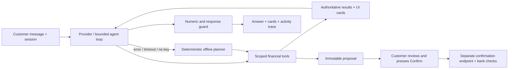
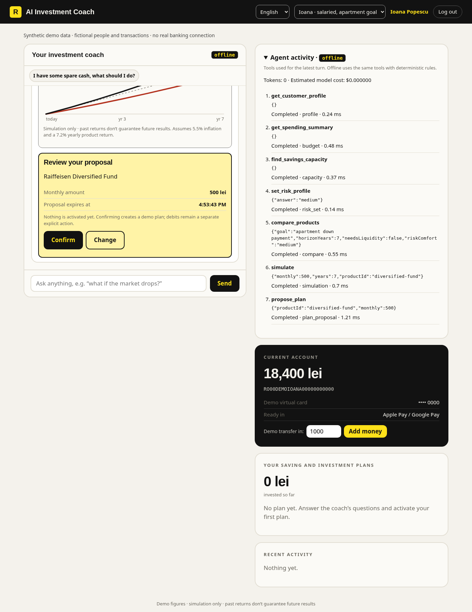
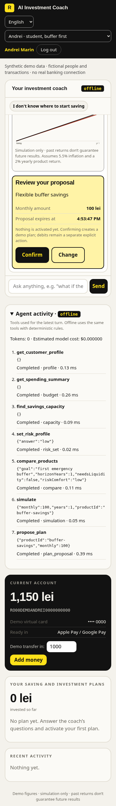
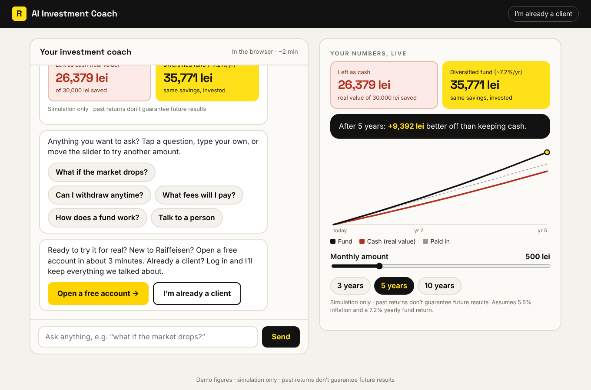
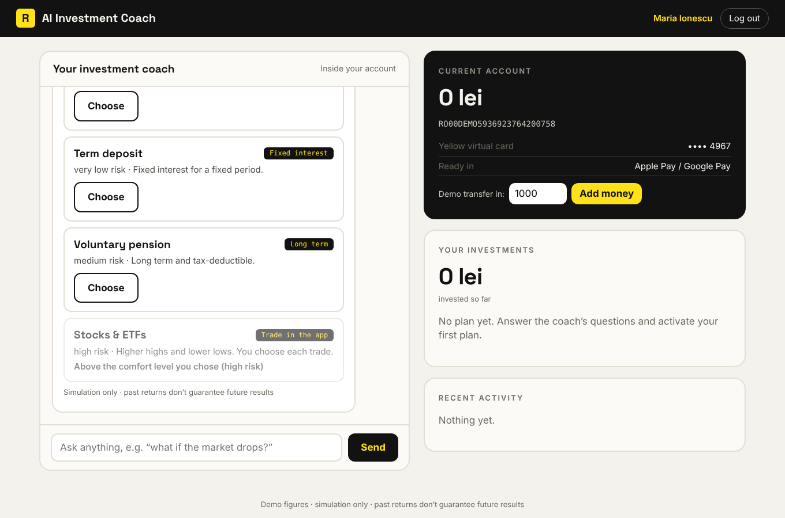
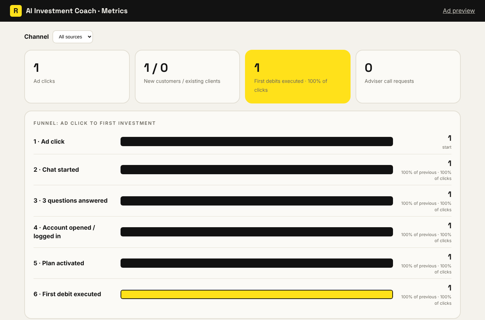

# NEXXT-AI · Raiffeisen AI Investment Coach

## Hackathon submission

**Track: AI for Scaling & Growth · Raiffeisen NEXXT VibeHack.** People need a decision they can act on: whether they can afford to invest, what they must keep accessible, and which product fits their goal. This demo serves salaried customers, students, freelancers and a small business using fictional profiles and twelve months of deterministic synthetic transactions.

The configured model chooses and calls tools through a bounded loop. It reads customer context, calculates capacity, compares products, explores changes and proposes a plan. With no key or a provider failure, a visibly labeled **offline** planner calls the same tools. Offline is rule-based; it is not presented as an AI model.



**Real in this repository:** the HTTP app, tool execution, capacity arithmetic, illustrative simulation, provider adapters, session scoping, proposal expiry and confirmation checks, audit, tests, evaluation and measurements. **Mocked:** people, transactions, product terms and returns, bank accounts, identity verification, SMS, phone approval and money movements. Data is fixed as of **2026-02-28** for repeatable demonstrations; the March tax obligation is relative to that synthetic date. No bank or eKYC service is connected.

Safety comes before conversion. Buffers, taxes and payroll are protected, product segment and suitability are checked on the server, model replies cannot invent numeric figures, and every activation needs the separate Confirm action. A chat message saying “yes” cannot activate a plan. Debits are separate demo actions and also preserve protected reserves. Merchant and profile text are untrusted data; tools accept no customer identifier.

**Evidence:** [EVAL_REPORT](docs/EVAL_REPORT.md) records **42/42 scripted scenarios**, including **22/22 safety scenarios**. This is deterministic CI evidence, not a live-model score. Live evaluation is **unrun without credentials**; the 90% live target is not claimed. [SCALE](docs/SCALE.md) records a short local run of **20/20 journeys, 80 requests, 364.47 requests/sec**, p50 **13.6 ms**, p95 **58.93 ms**, p99 **83.78 ms**, with limits enabled. These are loopback measurements with the app and load generator in one process, not production capacity. See [REPORT](REPORT.md) for the complete checklist and limitations.

### Run in 60 seconds

Needs Node 20+; no dependencies and no build. Node 24+ is recommended for the managed cloud proxy.

```bash
npm run setup          # creates .env only if absent; random local ADMIN_TOKEN
npm start
```

Open the app on port 3000, choose a **demo persona** in the header, click their suggested first prompt, then answer the risk question. The badge says `offline` without a configured key. `/ad` retains the anonymous acquisition flow; `/admin` retains the funnel and adds planning metrics. Get the local admin token from the ignored configuration using your editor; do not paste it into logs or version control.

```bash
npm test
npm run eval
npm run eval -- --live          # exits 2 if no real provider key is configured
npm run loadtest
npm run loadtest -- --concurrency=10 --journeys=20 --write-report
```

`npm run eval` writes the latest executed report. Live mode fails a quality scenario when a normal turn falls back to offline, preventing a fallback from being counted as live success. `loadtest` uses an isolated temporary JSON store, cycles all four personas and stops at a proposal; it never calls a provider or moves money. A larger burst can exit 1 with HTTP 429; that is an honest failed run.

### Providers, including Amazon Bedrock

Set values securely in `.env` or environment settings; all variables are described in [.env.example](.env.example). Never commit keys. A provider is selected automatically from available keys, or explicitly with `LLM_PROVIDER=anthropic`, `openai`, `bedrock` or `offline`.

| Provider | Required configuration |
|---|---|
| Anthropic Messages | `ANTHROPIC_API_KEY`; optionally `COACH_MODEL` |
| OpenAI-compatible Chat Completions | `COMPAT_API_KEY`, `COMPAT_BASE_URL` including the API prefix (for example `/v1`), and a compatible `COACH_MODEL` |
| Amazon Bedrock Converse | `AWS_BEARER_TOKEN_BEDROCK`, `AWS_REGION=eu-west-2`, and the exact `BEDROCK_MODEL_ID` or inference-profile ID/ARN |

Bedrock uses the regional HTTPS runtime endpoint and API-key bearer authentication, with no SDK dependency. **The requested Opus 5.5 identifier and availability in London are not verified.** Copy the identifier from the Bedrock console; do not use the display name or silently substitute another model. Adapters have mocked protocol tests; no real model response has been validated in this environment.

In this managed environment, enable Node 24's inherited proxy support **before starting Node**, keep the injected proxy/CA variables, and allow only the required provider destination:

```bash
NODE_USE_ENV_PROXY=1 npm start
NODE_USE_ENV_PROXY=1 npm run eval -- --live
```

For Bedrock the destination is `bedrock-runtime.eu-west-2.amazonaws.com`. Proxy secret bindings must target it. Anthropic uses `api.anthropic.com`; a compatible service uses the hostname from its configured base URL. `NODE_USE_ENV_PROXY` in `.env` alone is not a substitute for startup activation. Node 20 remains supported for the app and direct-network use; use Node 24+ for this proxy path.

The loop caps tool iterations at six, total time at 30 seconds (raise with `LLM_TIMEOUT_MS`, up to 60 000), and provider usage at the configured token budget. Configure actual per-million token rates with `LLM_INPUT_USD_PER_MILLION` and `LLM_OUTPUT_USD_PER_MILLION` to estimate model costs. Unpriced live usage is reported as unknown. This demo has no production monetary-budget ledger or provider backoff service.

### Three-minute demo script

Use a fresh demo database for a repeat presentation, or explicitly stop previous plans before proposing the same product again. Persona selection logs into shared fictional accounts; it does not reset their balances or active plans. All steps below work without a key.

| Time | Action | What the judges see |
|---|---|---|
| 0:00–0:30 | Select **Ioana**, click her suggested prompt, then **Medium risk**. | Spending, a three-month buffer, safe monthly amount, product comparison, simulation and a diversified-fund proposal. Expand **Agent activity** to show actual tool calls and the truthful mode badge. |
| 0:30–1:05 | Click **Change**, send “I need the money for a car in 2 years”. Review the new proposal and press **Confirm**. | An explained before/after diff and a deposit instead of a market-fund proposal. The old proposal is disabled. Confirmation creates the plan; it does not run a debit. Optionally show the separate demo debit button. |
| 1:05–1:35 | Select **Andrei**, click his suggested prompt, then **Low risk**. | “Do not invest yet”; specific subscriptions, a one-month buffer target and a 100 lei buffer-saving proposal. No investment is pushed. |
| 1:35–2:00 | Select **Mihai**, click his prompt, then **Medium risk**. | A six-month essentials buffer, a 12,000 lei tax reserve, liquid alternatives and a small 200 lei monthly proposal. |
| 2:00–2:25 | Select **Elena**, click her prompt, then **Low risk**. | Protected payroll, seasonal cash-flow analysis and a business deposit ladder; consumer products are marked unsuitable. |
| 2:25–2:45 | Change the header language to **Română**, select a persona and send its Romanian prompt. | Localized controls and deterministic Romanian answers; numeric formats are covered by guard tests. |
| 2:45–3:00 | Open `/admin` using the local token. Point to the committed eval and scale reports. | Existing funnel, mode split, tool use, cost per conversation/activated plan, proposal conversion and refusal audit. Say explicitly that live quality is unvalidated until real credentials are supplied. |




## Original acquisition flow

A working platform that turns a social ad into a first investment in one conversation.

**Social ad → chat in the browser → open an account or log in → the same chat continues inside the account → plan activated → first debit.**



## Run it

Needs Node 20+ (no `npm install`, there are no dependencies).

```bash
npm start
```

| URL | What it is |
|---|---|
| http://localhost:3000/ad | Fake social feed. Each ad opens the chat with its channel and campaign, so the funnel is attributed. |
| http://localhost:3000/ | The coach. |
| http://localhost:3000/admin | Funnel metrics and adviser call requests (token: `ADMIN_TOKEN`). |

**Try it:** click an ad, answer the three questions, open an account (the demo SMS code is shown on screen), answer the risk question, activate the plan, add demo money and run the first debit.
**Existing client:** log in with `+40 722 000 111` (Ioana Popescu, 18,400 lei; the same account and history as persona Ioana) and approve on the demo phone.

Copy `.env.example` to `.env` to change the port, admin token, or enable the optional Claude answers.

```bash
npm test      # 61 tests: original flows, tools, agent, confirmation, safety, providers and Romanian
```

For the new budget-aware planning demo, use the persona switcher. A newly opened account without linked spending history cannot receive an invented investment capacity; its safe next step is linking context or speaking to an adviser.

## What it does

| Step | Behaviour |
|---|---|
| **1 · Social ad** | `/?src=instagram&cmp=cash-loses` creates a tracked journey (cookie session). |
| **2 · Chat** | Three questions (how much, what worries you, how long), then a live simulation: 500 lei/month for 5 years is **35,771 lei** invested vs **26,379 lei** as cash in today's money (+9,392 lei). A slider and year buttons re-run it. One-tap answers for the worries: market drops (with a worst-timed 20% fall), withdrawing, fees, how a fund works. Free text is matched to the same answers. A person is one tap away (adviser call request with the conversation attached). |
| **3 · Two doors** | **New customer:** details, ID card number, selfie, SMS-code signature. Creates the profile, an account and a yellow virtual card. Steps are enforced in order, the code expires after 5 minutes and locks after 5 wrong tries, and only the last 4 ID characters are stored. **Existing client:** login request, approved on the "phone". Either way the conversation, amount, worry and horizon carry over. |
| **4 · In the account** | The coach greets by name, recalls the plan, asks one suitability question (how you would react to a 15% drop), then recommends a product and shows the shelf. Products above the customer's comfort level are shown but locked. One tap activates a monthly plan. Demo-only buttons add money and run the monthly debit; plans can be stopped. The coach checks in after each debit. |
| **Metrics** | `/admin`: ad click → chat started → 3 questions answered → account opened/logged in → plan activated → first debit executed, with conversion at each step, new vs existing clients, filter by channel, and adviser requests. |



## How it is built

```
public/        the web app (vanilla JS, no build step): chat, onboarding, login, account, ad page, admin
server.js      entry point
src/app.js     HTTP server, routes, sessions, rate limits, security headers
src/coach.js   the preserved anonymous conversation and FAQ
src/agent/     provider adapters, bounded tool loop and offline planner
src/tools/     scoped capacity, comparison, simulations and proposals
src/data/      deterministic synthetic profiles and spending histories
src/engine.js  the only source of investment numbers
src/bank.js    stand-ins for the bank's systems: customers, eKYC, SMS signing, accounts, cards, plans, ledger
src/products.js product shelf and suitability caps
src/analytics.js funnel events
src/llm.js     optional Claude answers with a numbers guardrail
src/store.js   JSON-file persistence (data/db.json)
```

**The AI talks, the bank's systems do the numbers, identity checks and money movement.** Concretely:

- Every figure shown comes from `engine.js` or the product catalogue, never from a language model.
- Optional: configure Anthropic, an OpenAI-compatible service or Bedrock as described above. The agent calls the tools; invented numeric figures are rejected, and a failed provider turn uses the deterministic offline planner.
- The coach never moves money. Plans are created and debited only through `bank.js`, after a suitability check.
- Results carry "Simulation only · past returns don't guarantee future results".

### API (JSON, cookie session)

`POST /api/journey` · `POST /api/chat` · `GET /api/simulate?monthly=&years=` · `POST /api/signup/{details,id,selfie}` · `POST /api/signup/otp/{request,verify}` · `POST /api/login/request` · `GET /api/login/status` · `GET /api/me` · `POST /api/plans` · `POST /api/plans/:id/{run-debit,stop}` · `POST /api/handoff` · `GET /api/admin/{metrics,handoffs}` (header `x-admin-token`)

## Going from demo to production

The demo is complete end to end, but these parts are deliberately stand-ins and must be replaced before real customers use it:

| Demo stand-in | Replace with |
|---|---|
| `bank.js` customer records, accounts, ledger, plans | Raiffeisen core banking and investment platform APIs |
| ID card number check, selfie flag | A real eKYC provider (document scan, liveness, face match) |
| SMS code returned on screen (`DEMO_MODE=1`) | An SMS provider. Set `DEMO_MODE=0`: codes are never returned, and top-up, run-debit and phone-approval endpoints are disabled |
| "Approve" on the demo phone | Push approval in the real Raiffeisen app |
| `data/db.json` | A real database |
| Fees, settlement days, return and inflation assumptions (`products.js`, `engine.js`) | The product team's confirmed figures |
| Appropriateness check = one question | The bank's regulated suitability / appropriateness questionnaire |
| English only | Romanian (and other) copy, reviewed by compliance |

Also before launch: legal and compliance review of all wording, GDPR consent and retention, HTTPS in front of the server, and a strong `ADMIN_TOKEN`.



## Pitch deck

The summit deck is in `deck/` and `source/` (the original product overview). Live deck: https://claude.ai/artifact/Lvt21B54qY9D9EPxJBwTu2
